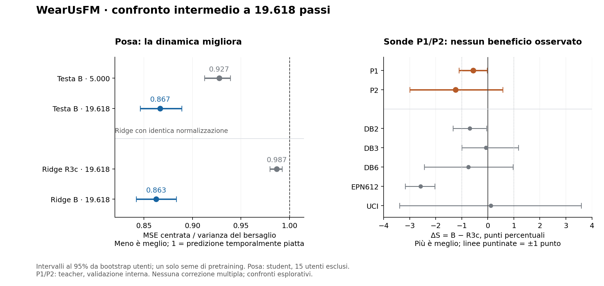

# B a 19.618 passi: posa migliore, trasferimento non migliorato — 29/10/2026

**La supervisione di posa migliora la regressione su utenti esclusi dal training e rende la dinamica piu' accessibile
nei latenti mediati. Con la ricetta e le sonde previste non migliora invece P1/P2: P1 cala leggermente, P2 ha una stima
negativa e piu' incerta, EPN612 mostra un calo netto nella lettura esplorativa. Raccomando di conservare B come ramo
per la posa, senza adottarlo come miglioramento generale del FM o prolungarlo automaticamente a 49.046 passi.**

Questa lettura completa quella [preliminare](b19618_preliminary_20261029.md), ora superata per disponibilita' dei JSON.
Protocollo congelato: [continuazione B19618](../continuazione_b19618_20261028.md). Nessuna nuova soglia, selezione del
checkpoint o ottimizzazione sulla val. Un solo seme, lettura intermedia esplorativa, test ufficiali intatti.

## Esecuzione e provenienza

Training 62582916 continuo da 5.001 a 19.618, 14.618 righe senza salti, LR 1e-4, arresto `max_steps`, exit 0,
`source_unchanged=true`; concluso il 29/10 alle 01:21:51 Europe/Rome. Checkpoint B `96f87035520e291e1d96920722ae89bd440b4e5c5cbb335b7a04d65e75bfc229`;
R3c `ee78d2a96264322258f73b2b3b249c800b76276fb557f5023c5d76830b243e29`. Codice scientifico congelato a 24139ab.
Le comparazioni sono student per posa/accessibilita', teacher per P1/P2, entrambi a 19.618 dove previsto.

Confronto finale 62618179 concluso alle 03:19:22. Fra i 17 ID della tranche: 14 COMPLETED con exit 0:0, un FAILED storico della
guardia P2 recuperato senza rifit, due CANCELLED prima dell'avvio. Nessun job in coda nello snapshot delle 09:13.
Raccolta di semplicione alle 09:13: 60 file testuali, 28,8 MB, tutti con SHA remoto/locale coincidenti. Il permesso runtime
precedente e' risolto; nessun nuovo consenso o job necessario per questa lettura.

Verifiche indipendenti: 60 hash ricalcolati, 198 controlli di integrita'/accounting, 1.049 confronti numerici/provenienza
del rapporto posa senza discrepanze. Ricalcolati da somme per utente i bootstrap della posa; ricalcolati delta e
pesi delle sonde. Gli IC delle sonde sono quelli del confronto congelato, non un bootstrap locale rieseguito sugli OOF.
Checkpoint, cache e OOF non sono stati scaricati/rihashati in questa raccolta: valgono i pin incrociati e le guardie
riuscite dei job. Il recupero R3c-P2 identifica 62618174 e conserva il rapporto originale.

## A. La testa migliora anche il movimento fuori dal train

Stessi 15 utenti, 18.548 finestre estratte, 8.329 dinamiche e 21.750.080 elementi validi nel primario; supporti identici.
La definizione delle dinamiche resta quella congelata dalla varianza del target. La scomposizione temporale usa
solo celle finestra/giunto con almeno 2 istanti validi.

| Misura sulle dinamiche | B5.000 | B19.618 | Delta appaiato B19.618−B5.000, IC95 |
|---|---:|---:|---:|
| MAE/costante train (E1) | 0,937552 | 0,862629 | −0,074922 [−0,089755; −0,059466] |
| MSE centrata / varianza target | 0,927475 | 0,866689 | −0,060786 [−0,075004; −0,045008] |
| Varianza predetta / target | 0,063240 | 0,149608 | descrittivo |
| Correlazione temporale centrata | 0,269936 | 0,365725 | descrittivo |

Entrambi gli errori migliorano in 15/15 utenti. MAE assoluta 0,334879→0,308117 rad, contro costante 0,357184 rad;
mediana dei rapporti individuali 0,947380→0,864783. La riduzione rispetto all'errore B5.000 e' **7,99% per MAE** e
**6,55% per MSE centrata**: non confonderla con 7,49 e 6,08 punti di differenza dei rapporti. A 19.618 E1 e' 13,74%
sotto la costante, mentre l'errore centrato e' 13,33% sotto il riferimento temporalmente piatto.

Il miglioramento non riguarda solo la postura media: nelle dinamiche la riduzione MSE standardizzata totale 0,079776
si scompone in 0,047346 sul livello medio e 0,032429 sulle variazioni. Sono componenti additive sullo stesso supporto,
non percentuali causali dell'apprendimento. Su tutte le finestre il miglioramento del livello resta predominante.
La varianza predetta arriva al 14,96% di quella reale: traiettorie meno piatte rispetto a 5.000, ancora attenuate.
Non e' una prova che basti moltiplicare le uscite per recuperarne il movimento. La componente centrata puo'
includere variazioni lente: questa analisi non dimostra ancora inseguimento rapido.

Poco dinamiche: rapporto centrato 1,059447→1,005051, IC del nuovo rapporto [0,993236; 1,017111]. Si riduce il precedente
peggioramento; non emerge un beneficio netto rispetto al riferimento piatto, ne' si dimostra equivalenza. A 19.618
7/15 utenti hanno guadagno centrato positivo e 8/15 negativo. Non chiamare automaticamente queste finestre "riposo".

E2 sul supporto comune di 8.003 finestre/14 utenti: gap disallineato−allineato 0,017654→0,043334 rad;
IC del nuovo gap [0,037665; 0,049309], delta +0,025680 [+0,022503; +0,028799]. Cresce in 14/14 utenti valutabili.
Misura associazione, influenzata anche dal livello della posa; la prova specifica del movimento viene dalla
scomposizione centrata, non dalla sola crescita di E2. Nessun cancello finale E1/E2 applicato all'intermedio.

## B. P1/P2 non migliorano a pari passo

Teacher, media dei canali, larghezza 768, nessuna PCA. Stessi ingressi/split/fold/seed/ricetta, con verifica di
provenienza delle righe OOF. S e' espresso in percentuale; delta e IC in punti percentuali.

| Misura | R3c19.618 | B19.618 | Delta B−R3c | IC95 appaiato |
|---|---:|---:|---:|---:|
| **P1** | 17,551 | 16,995 | **−0,556** | **[−1,104; −0,026]** |
| **P2** | 80,837 | 79,604 | **−1,233** | **[−2,997; +0,576]** |
| DB2 | 18,807 | 18,116 | −0,692 | [−1,333; −0,046] |
| DB3 | 2,765 | 2,699 | −0,065 | [−0,997; +1,176] |
| DB6 | 34,704 | 33,953 | −0,751 | [−2,442; +0,969] |
| EPN612 | 84,399 | 81,820 | −2,580 | [−3,172; −2,032] |
| UCI | 77,275 | 77,389 | +0,114 | [−3,392; +3,591] |

P1 ha un piccolo calo con IC sottozero; P2 non risolve il segno ma comprende danni prossimi a 3 punti. Entrambi gli
IC aggregati escludono +1 punto in questa lettura, condizionata al singolo seme e alla procedura delle sonde.
Non e' dimostrata assenza di danno: anche P1 comprende cali superiori a 1 punto. Il campo legacy
`not_harmful=true` di P1 usa la stima puntuale e non sostiene quella conclusione; le etichette del comparatore
non sono nuovi criteri di adozione.

P2 pesa al 50% EPN612 (314 soggetti) e UCI (19 soggetti), come congelato: l'incertezza UCI contribuisce molto al suo
intervallo. DB2 ed EPN612 calano nei 4 fold, senza che questo significhi tutti i singoli utenti. Nessuna correzione
per confronti multipli: i dataset restano descrittivi. Gli IC utenti non comprendono la variabilita' fra semi
di pretraining. P1/P2 sono **sonde di classificazione su validazione interna**; non il test ufficiale su nuovi
utenti/dataset dell'encoder e non una valutazione di trasferimento su una diversa regressione.

## C. Il vantaggio di posa e' visibile anche nei latenti

Stessa media K e LayerNorm stateless FP32, stessa ridge e stessi 40 utenti train in 2 fold, 15 utenti val disgiunti.
Il confronto riguarda questa vista normalizzata, che elimina media/norma istantanee; non tutta l'informazione
dei latenti grezzi o non mediati.

| Misura ridge, finestre dinamiche | R3c19.618 | B19.618 | Delta B−R3c, IC95 |
|---|---:|---:|---:|
| MAE/costante | 0,969702 | 0,861092 | −0,108610 [−0,122256; −0,093573] |
| MSE centrata / varianza target | 0,986693 | 0,862650 | −0,124044 [−0,142974; −0,105411] |
| Correlazione centrata | 0,131095 | 0,370608 | descrittivo |

Errore centrato inferiore in 15/15 utenti, E1 in 14/15. Questo rafforza l'evidenza di una rappresentazione piu'
utile alla posa, oltre alla sola testa appresa. Non implica un miglioramento universale delle rappresentazioni.

Alpha selezionato 1e5 per entrambi, minimo interno dopo estensione della griglia fino a 1e6, `boundary_unresolved=false`.
M2 B: massimo errore train 0,000191808 / val 0,000188470 e RMSE circa 0,000026, sotto 0,005 / 0,0005 preventivi; R3c senza
testa non applicabile, come atteso. Nessun problema di bordo o ricostruzione della testa emerso. Il numero 0,862650
della ridge B e' vicino a 0,866689 della testa: non e' un test di equivalenza o ottimalita', ne' va confrontato
numericamente con il vecchio E3 B5.000 che usava la LayerNorm appresa.

## Limiti concreti delle sonde

- **18 emissioni di ConvergenceWarning lbfgs**, distribuite 5/4/4/5 fra R3c-P1 / R3c-P2 / B-P1 / B-P2. Il log non identifica
  C, fold o fit candidato/finale: non si puo' dichiarare che siano tutti fit finali, ne' certificarne la convergenza.
  Il risultato resta quello della ricetta congelata, con una verifica di robustezza ancora utile.
- **489 warning di classi predette assenti per ciascun P1**, nella fase DB3, 978 messaggi complessivi: omessi dal
  primo `warnings_summary.json` dell'operatore e aggiunti nelle review indipendenti. Classi apprese possono
  mancare nel sottoinsieme corrente di scoring/bootstrap; questo non prova label spurie. Il confronto appaiato
  conserva target e denominatori comuni, quindi il warning da solo non invalida delta o pairing.
- UCI scarta la stessa singola riga malformata in entrambi i bracci; due eventi nei log, stesso hash degli ingressi. Nessuna
  esclusione diversa fra modelli dimostrata. Conservati i log originali, senza modifiche alla ricetta dopo i numeri.

## Valutazione e seguito raccomandato

1. **La regressione di posa funziona e beneficia della dose aggiuntiva.** H1 del dbg resta sostenuta; niente plateau
   dedotto da due checkpoint. Il movimento fuori dal train migliora, pur restando debole rispetto al target.
2. **Il miglioramento della posa non si trasferisce alle classificazioni misurate.** Quadro compatibile con
   specializzazione e possibile costo su altri task. Non dimostra che la scala dei dati sia insufficiente o che
   un FM multicanale sia un'idea sbagliata. L'utilita' per altre regressioni rimane non misurata.
3. **Conservare B come ramo posa; non adottarlo ora come nuovo backbone generale e non estendere automaticamente
   la stessa ricetta a 49.046.** I risultati non motivano un cambio indiscriminato della distanza MSE→L1/Huber.
4. **Prossimo controllo da preparare:** attribuire i warning ai fit delle sonde e verificare simmetricamente la
   convergenza usando le feature congelate, senza nuovo training GPU, tuning sul test o miglioramenti riservati
   a un solo encoder. Solo dopo valutare un eventuale confronto con maggiore limite di iterazioni/tolleranza
   fissati prima. E' una proposta di robustezza, non un job lanciato in questa consegna.
5. Il controllo dei latenti non mediati resta diagnostico per il ramo posa; una loss centrata/di velocita' resta
   un'ipotesi di training. Per la domanda FM e' piu' informativo definire anche un trasferimento verso una
   regressione distinta dalla posa supervisionata prima di investire un altro braccio lungo. Nessuno di questi
   controlli e' gia' eseguito, e non si riutilizza la val osservata come banco di selezione ripetuta.

## Consuntivo e materiali

Tranche di 17 job, incluso preflight: **14,622778 GPU-ore**, 143,967222 core-ore allocate, di cui 26,985 CPU-only.
Il preflight da 0,012222 CPU-core-ore era gia' contato nella base: incremento netto CPU-only 26,972778.
Seconda ondata cumulata **67,551944 GPU-ore / 98,86 CPU-only core-ore**; residuo sui tetti 132/531:
**64,448056 GPU-ore / 432,14 CPU-only core-ore**. Sono tetti sperimentali, non saldo del conto condiviso CINECA.
Il vecchio job P2 fallito resta nel consuntivo. Nessun nuovo esperimento o consumo GPU per questa lettura locale.

Materiali: [JSON e metadati raccolti](../../results/infra/pilot_posa/b19618_20261029/final/),
[sintesi numerica](../../results/infra/pilot_posa/b19618_20261029/analysis_summary.json),
[review indipendenti](../../results/infra/pilot_posa/b19618_20261029/independent_reviews/),
[grafico PDF](../../results/infra/pilot_posa/b19618_20261029/b19618_results.pdf).
L'archivio versionato conserva 56 dei 60 file originali e un aggregato del pannello train; tracce voluminose e manifest
di finestre restano nella raccolta locale completa, con hash registrati in `archive_selection.json` e `manifest.json`.
