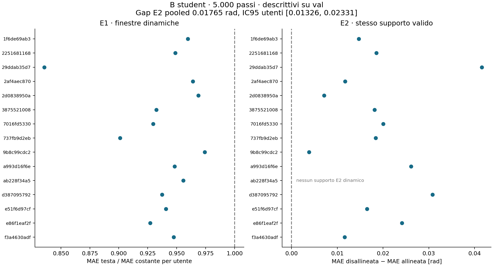

# B a 5.000: E1/E2 sui 15 utenti esclusi dal training

28/10/2026, GPT. Estrazione **62539724** e rapporto **62540295**, entrambi **COMPLETED, 0:0**.
Codice scientifico congelato `24139ab901c052357a46a65bc20466f2eb1e8358`; piano e wrapper pubblicati in `78e9b2c`,
precisazioni di lettura registrate prima dei risultati in `dd8ede7`. Nessun nuovo job o addestramento durante questa lettura.

**La testa mostra un beneficio modesto ma coerente su utenti esclusi dal training. Il beneficio dipende dall'associazione
con la finestra corretta; resta da separare la postura media dal movimento dentro la finestra.** Questa e' una lettura
descrittiva a 5.000, non il verdetto E1/E2 all'endpoint firmato di 49.046 passi e non un'autorizzazione a R3 completo.

Fonti: [protocollo](../valutazione_b_e1e2_20261028.md),
[rapporto originale](../../results/infra/pilot_posa/b_e1e2_20261028/final/report.json),
[analisi riproducibile](../../results/infra/pilot_posa/b_e1e2_20261028/analysis/analysis.json),
[provenienza e consuntivo](../../results/infra/pilot_posa/b_e1e2_20261028/README.md).

## Risultati descrittivi

| Misura | Risultato | Lettura |
|---|---:|---|
| E1, MAE testa sulle dinamiche | 0,334879 rad | Costante del train: 0,357184 rad |
| E1, rapporto testa/costante | **0,937552**, IC95 **[0,917038; 0,952262]** | Riduzione **6,245%**, IC95 [4,774%; 8,296%] |
| E1, mediana dei rapporti utente | **0,947380** | Tutti i 15 utenti hanno rapporto <1; non sono 15 test individuali significativi |
| E1, tutte le finestre con posa | 0,944309, IC95 [0,916758; 0,967307] | Riduzione 5,569% |
| E1, finestre poco dinamiche | 0,952450, IC95 [0,905300; 0,990042] | Riduzione 4,755% |
| E2, rapporto disallineato/costante | **1,007443**, IC95 **[0,996323; 1,016716]** | Compatibile con errore vicino alla costante |
| E2, MAE allineata sul supporto comune | **0,333954 rad** | Confronto appaiato sulle stesse maschere e con gli stessi pesi |
| E2, MAE disallineata sul supporto comune | **0,351608 rad** | Aumento del 5,286% rispetto all'allineata |
| E2, gap disallineata meno allineata | **0,017654 rad**, IC95 **[0,013260; 0,023309]** | Gap positivo in **14/14 utenti valutabili** |

L'IC del gap e' calcolato dal JSON per utente con il metodo fissato prima dei risultati: 1.000 ricampionamenti appaiati
degli utenti, seme 20261009, medie aggregate con pesi degli elementi validi, percentili 2,5/97,5. Si ricampionano i **14**
utenti effettivamente presenti in E2, non si inventa un valore per il quindicesimo. Mediana del gap utente 0,018256 rad;
range 0,003812–0,041594 rad. Il ricalcolo indipendente del gap e del suo IC coincide.

Il rapporto originale conserva `E1.learned=false` e `E2.misaligned_ok=true`. I numeri non raggiungono la dimensione del beneficio
richiesta da E1 al termine del training; a 5.000 **non li convertiamo in un verdetto scientifico di superamento o fallimento**.
Non interpretiamo E2=true come dimostrazione di equivalenza alla costante o di ricostruzione corretta della traiettoria.

## Copertura e limiti del controllo

- CSV val completo: 1.950 registrazioni, 15 utenti disgiunti dai 158 utenti emg2pose del manifest train. Sono 1.950
  registrazioni richieste, non tutte con finestre: **1.923 con finestre, 27 senza**, secondo la provenienza della cache.
- Estratte **18.548 finestre**, **16.684 con almeno un elemento valido** di posa. E1 dinamiche: **8.329 finestre / 15 utenti**;
  poco dinamiche: 8.329. Le altre 26 hanno supporto valido ma varianza temporale non definita: il codice richiede piu' di una
  patch valida per classificare la dinamica. Restano in E1 tutte, senza essere attribuite a uno dei due gruppi.
- E2: **8.003 finestre dinamiche / 14 utenti / 18.256.160 elementi validi**, 96,09% delle finestre dinamiche E1. L'utente
  `ab228f34a5` ha solo 7 finestre dinamiche in E1 e nessuna coppia conservata in E2. Non si estende a lui il risultato E2.
- Sul supporto finale E2, **7.993 coppie della stessa registrazione**, con distanza di almeno 8s, e **10 fallback ad altra
  sessione**. Tutte mantengono utente, fase e lato; **zero** esclusioni per statistiche incompatibili.
- Il pairing prima della selezione dinamica conserva 14.269 coppie su 18.548 finestre; 4 senza candidato. La voce frozen
  `n_dropped_near_identical=4275` include anche coppie senza distanza finita per assenza di supporto comune: non equivale a
  4.275 coppie tutte quasi identiche, ne' al solo decile scartato. Il JSON non separa questi motivi; non li ricostruiamo inventando conteggi.

L'IC ricampiona utenti, non tratta migliaia di finestre come soggetti indipendenti. Restano 15 utenti in E1 e 14 in E2,
un solo checkpoint e un solo seme di training. L'IC non misura la variabilita' fra run ne' il trasferimento ad altri dataset.

## Che cosa cambia nella diagnosi

Il risultato aggiunge al pannello train di B un beneficio su **utenti esclusi dal training**: la testa non migliora soltanto
sui soggetti visti. E1 mostra un vantaggio di circa il 6% sulle finestre dinamiche, con IC interamente sotto 1 e segno coerente
fra utenti, ma una riduzione ancora contenuta dell'errore assoluto.

Il gap E2 e' positivo in tutti gli utenti valutabili e il suo IC e' sopra zero. Questo sostiene l'utilita' dell'associazione
fra predizione e finestra corretta nel controllo adottato. **Anche una testa che stima bene la postura media di ciascuna finestra
puo' produrre questo gap**: scambiare il bersaglio cambia sia la traiettoria sia il suo livello medio. Inoltre riuso dei partner,
selezione per distanza e margini diversi dei target impediscono di trattarlo come una misura causale pura dell'informazione temporale.
Non si sottraggono direttamente i rapporti E1 ed E2: supporti e costanti di riferimento differiscono.

H1 (dbg troppo breve) resta sostenuta dal collaudo B; ora c'e' anche un primo beneficio fuori dai soggetti di training.
H2 nella forma estrema «nessuna informazione utile per la posa» e' meno plausibile. Rimane aperta la forma rilevante:
quanto movimento dentro la finestra e' rappresentato e utilizzato dalla testa? La varianza predittiva piccola nel pannello train
e questi risultati sono compatibili: non dimostrano ancora una buona ricostruzione della dinamica.

Non confrontare il 6,245% direttamente con l'11,713% di B come misura di un divario train/val: cambiano metrica (MAE rad contro MSE
standardizzata), popolazione, selezione, pesi e vista dell'encoder (senza maschera qui, mascherata nel pannello B).

## Passo successivo raccomandato, non lanciato

Per la domanda ancora aperta, la lettura piu' diretta e' **separare postura e dinamica nella cache gia' prodotta**, senza altra
inferenza GPU o training. Per finestra e giunto, sul medesimo supporto valido, la MSE si scompone esattamente in errore quadratico
delle medie e errore fra le due traiettorie centrate. Quest'ultimo si puo' descrivere contro il predittore centrato nullo,
insieme a varianze di predizione/target e covarianza, con aggregazioni per utente dichiarate prima del calcolo.

E' una diagnostica che usa la media del bersaglio osservato, quindi un oracolo descrittivo, non una baseline disponibile in uso.
Il JSON attuale non contiene gli istanti o i prodotti incrociati necessari: serve leggere la cache remota. Una sua eventuale
esecuzione CPU va preparata con script, review, preventivo e via; **nessun job aggiuntivo e' stato sottomesso**.
E3 sui latenti B resta utile per l'accessibilita' lineare, ma richiede l'estrazione train ed e' meno diretta per questa domanda.
Non cambierei ancora pooling, testa, peso della posa o lag sulla base di questi dati. R3 completo rimane una decisione separata.

## Integrita', costo e consegna

Guardie di estrazione e rapporto entrambe superate. Student al passo **5.000**, configurazione/statistiche/codice/wrapper attesi;
checkpoint immutato fra le due fasi, SHA256 `815956b98d27cd2ff71f1255d0e220e2b0e08e467e7bedf93a54d0984b10783e`.
Cache di 2.484.409.931 byte, SHA256 `70bb551309b502565d38072abf41ffee322a06de14589d36b720570f1cfbfa46`, rimasta sul cluster.
Gli hash registrano la provenienza verificata nel compute node: non sono stati ricalcolati leggendo la cache sul Mac.
Copiati e verificati localmente report, provenienze e log, senza dati grezzi, checkpoint o NPZ nel repository.

| Job | Orari Europe/Rome del 28/10 | Durata allocazione | GPU-ore | Core-ore |
|---|---|---:|---:|---:|
| Estrazione 62539724 | 11:05:40–11:31:47 | 26min07s | 0,435278 | 3,482222 |
| Rapporto 62540295 | 11:32:33–11:33:24 | 51s | 0 | 0,113333 |
| **Totale** | | | **0,435278 / tetto 0,666667** | **3,595556 / tetto 8** |

Tempo del solo estrattore 1.488,90s, del solo rapporto 20,04s; l'allocazione include le guardie e la preparazione.
Consuntivo da righe di allocazione SLURM, senza sommare nuovamente gli step batch/extern. Massima RSS batch: 17,13GiB e 4,19GiB.
La raccolta iniziale ha avuto errori SSH intermittenti, poi si e' conclusa tramite lo stesso accesso senza modificare configurazioni;
non sono errori dei job. Coda dei due job vuota al controllo. Nessun rilancio.

Verifiche della consegna: confronto hash e provenienze, identita' del checkpoint, conteggi e aggregati; calcolo indipendente
dell'IC del gap e review scientifica. Il codice di training e il rapporto frozen restano invariati; non serve rilanciare la suite
del trainer per questa analisi locale dei risultati.
