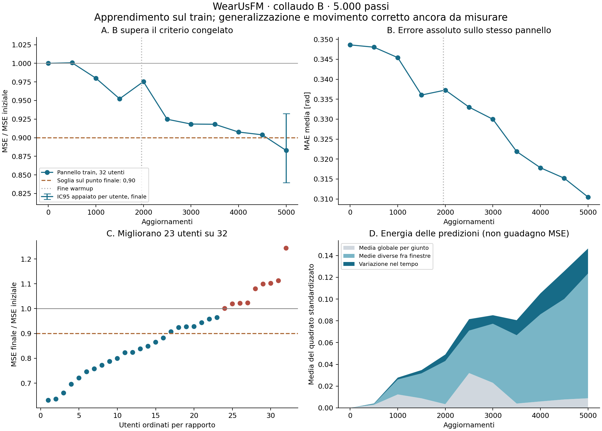

# B completato: esito e lettura scientifica

28/10/2026, GPT. Job **62523672**, codice congelato **24139ab901c052357a46a65bc20466f2eb1e8358**.
Richiesta di Simone: «finito direi, leggi, commenta e analizza». Raccolta remota di sola lettura, analisi locale dei risultati,
due verifiche indipendenti (ricalcolo numerico e critica scientifica). Nessun nuovo job, training o cambiamento di criterio.

**B e' SUPERATO. La ricetta estesa riduce l'errore di posa sul pannello train.** Questo supera il blocco operativo del collaudo B,
ma non dimostra ancora che il modello ricostruisca correttamente il movimento su utenti nuovi o che migliori il trasferimento.
Il dbg resta non superato secondo la sua regola; il risultato nuovo non ne riscrive l'esito.

Riferimenti: [protocollo congelato](../collaudo_r3_b_20261028.md),
[verdetto eseguibile](../../results/infra/pilot_posa/collaudo_b_20261028/verdetto.json),
[ricalcolo descrittivo](../../results/infra/pilot_posa/collaudo_b_20261028/analisi.json),
[fonti e riproduzione](../../results/infra/pilot_posa/collaudo_b_20261028/README.md).

## 1. Esito senza cambiare le soglie

| Misura sul pannello di 32 utenti / 256 finestre | Passo 0 | Passo 5.000 | Variazione |
|---|---:|---:|---:|
| MSE standardizzata, primaria | 1,160059 | 1,024176 | **−11,713%** |
| MAE standardizzata | 0,876560 | 0,800041 | −8,729% |
| MAE in radianti | 0,348610 | 0,310489 | **−10,935%** |

Rapporto primario **0,8828655883**, IC95 bootstrap appaiato per utente **[0,8394701934; 0,9322308875]**
(1.000 repliche, seme 20261027). Entrambe le condizioni sono soddisfatte: punto <=0,9 e limite superiore <1.
L'intervallo della riduzione e' **[6,777%; 16,053%]**: non dimostra un calo di almeno il 10% al 95%, cosa che il criterio non richiedeva.
L'intervallo descrive il pannello train e non e' un intervallo di generalizzazione a utenti esclusi dal training.

Passano tutti i controlli tecnici e d'integrita': config effettiva identica all'attesa, SHA codice e statistiche corretti,
5.000 record consecutivi, 11 valutazioni, supporti e identita' invariati, baseline della testa a zero, composizione della loss,
conteggi, scala/tetto della posa, ritmo e assenza di allarmi di collasso. `checkpoint.pt` e' presente, **454.215.776 byte**;
non e' stato scaricato o caricato. La verifica dello stato interno per una ripresa resta separata.

Una prima invocazione del lettore aveva ricevuto `ls -l /percorso/checkpoint.pt`, con nome assoluto: il parser, che richiede
`ls -l` della directory, non trovava il basename. Conservati output e verdetto iniziali per tracciabilita'; ottenuto l'elenco
grezzo della directory con `checkpoint.pt`, il lettore congelato passa senza alcuna modifica. Non e' un checkpoint mancante,
un cambiamento di soglia o un difetto del run.

## 2. L'apprendimento e' graduale e diverso fra utenti

| Passo | MSE / MSE iniziale |
|---|---:|
| 1.000 | 0,980064 |
| 2.000 | 0,975408 |
| 3.000 | 0,918346 |
| 4.000 | 0,907607 |
| 4.500 | 0,903846 |
| **5.000, endpoint fissato** | **0,882866** |

La traiettoria non e' monotona. Il primo endpoint misurato sotto0,9 e' quello finale; non abbiamo scelto il checkpoint migliore.
Dal passo2.000 al5.000 la MSE del pannello scende di **9,488%**. La loss di posa dello stream scende di **4,786%** fra
2.001–2.500 e4.501–5.000 (0,944815→0,899598, 498 passi con posa in ciascun blocco): finestre differenti, quindi confronto
descrittivo non appaiato. Il pannello piccolo di stabilita', con32 finestre di posa, scende di8,135% in MSE e7,741% in MAE rad.
Queste letture hanno distribuzioni diverse e non sostituiscono il primario.

**23/32 utenti migliorano**,16/32 di almeno il10%; nove peggiorano. Rapporti individuali minimo/mediana/massimo:
**0,631/0,894/1,243**. Migliorano165/256 finestre. Non e' un beneficio uniforme, ne' una convergenza dimostrata.

Il pannello ha64 registrazioni, frazione valida media82,10%, supporti2–160 patch per finestra;39 finestre sotto meta' supporto
e5 sotto10 patch. Tutti i20 giunti di ogni finestra hanno lo stesso supporto, con almeno2 patch.
Le quattro registrazioni scartate in selezione avevano meno di quattro finestre eleggibili; nessuna selezione basata sull'errore.

Sensibilita' **post hoc**, esclusivamente descrittiva, a peso uguale per finestra nei sottoinsiemi:

- 137 finestre con supporto completo: rapporto0,911826;119 parziali:0,852736.
- Escludendo le5 finestre sotto10 patch:0,874668. Il passaggio non e' provocato dalle sole finestre quasi vuote.
- 220 finestre prompted:0,879542;36 unprompted:0,921959. Il guadagno non e' confinato alla mano non sollecitata.
- Lato sinistro116 finestre:0,833497; destro140:0,925676. Utenti/fasi e composizione differiscono: non identifica una causa laterale.

Questi sottoinsiemi non hanno le quote del primario e non sono nuovi test di passaggio. Non si cambiano maschere, pesi o popolazione
dopo aver visto i risultati; in particolare la media dei rapporti utente non sostituisce il rapporto delle medie.

## 3. Dose, gradienti e stabilita'

B ha visto **160.000 finestre globali**, di cui **36.620 esposizioni a finestre con posa**,7,324 per aggiornamento.
Sono conteggi globali gia' ridotti fra le quattro GPU: non moltiplicarli ancora per quattro, ne' chiamarli finestre uniche.
Nel dbg erano9.332 esposizioni. La somma dei LR e'0,40195, ossia4.019,5 unita' al picco contro671 del dbg; e' circa5,99 volte
l'integrale del LR, non5,99 volte l'aggiornamento Adam o un guadagno atteso.

La posa e' presente in4.991/5.000 passi (99,82%). Rapporto delle loss pesate posa/ancore:0,247955 nei primi100 passi;
0,744593 nell'intervallo500–5.000, entro i limiti congelati.

E4 offre10 misure: rapporto medio delle norme posa/ancore **0,917802**, range0,172773–2,451142; coseno medio−0,060016.
Il gradiente di posa e' quindi apprezzabile nei moduli condivisi sui micro-batch osservati; non e' vicino alla soglia descrittiva
dell'1%. **E4 resta locale al rank e all'ultimo micro-batch**, prima della riduzione DDP: non misura direttamente l'aggiornamento
globale dell'encoder e il coseno medio non dimostra un conflitto sistematico fra gli obiettivi.

La norma totale pre-clipping supera1 in tutti i passi; fattore di clipping minimo/mediano/massimo0,03174/0,24758/0,75811.
Questo non indica da solo un difetto, non e' un LR effettivo di AdamW e non giustifica aumentare peso o soglia.
Nessun allarme di collasso; rango effettivo student nei dieci controlli72,61–84,09, finale83,84. Il rango resta una diagnostica
di stabilita', non una misura di qualita' del modello.

## 4. La testa produce variazione, ma il movimento corretto e' ancora da verificare

La varianza temporale media delle predizioni per giunto cresce da0 a **0,023003**; e' positiva in tutte le256 finestre
(minimo0,000233, mediana0,016321, massimo0,144513). La testa non restituisce soltanto un vettore uguale in ogni istante.

Grazie ai supporti uniformi fra giunti, dai log si puo' ricostruire la **scomposizione dell'energia delle predizioni**:

| Componente a5.000 | Valore |
|---|---:|
| Media del quadrato delle predizioni | 0,146445 |
| Variazione temporale entro finestra e giunto | 0,023003 (15,71%) |
| Quadrato delle medie temporali per finestra/giunto | 0,123441 (84,29%) |
| Di quest'ultima: quadrato della media globale per giunto | 0,008853 |
| Di quest'ultima: variazione delle medie fra finestre | 0,114589 |

**Queste percentuali non sono quote del miglioramento della MSE.** Una posa corretta puo' avere una forte componente lenta;
una predizione variabile puo' anche essere sbagliata. Mancano le medie dei target per giunto e i prodotti incrociati temporali
predizione-target: non e' identificabile quanta parte del guadagno venga da postura, contesto, bias o movimento allineato.
Non traduciamo0,023 in una frazione di varianza del bersaglio spiegata.

## 5. Aggiornamento della diagnosi e raccomandazione

**H1, dbg troppo breve: piu' plausibile.** Con la ricetta estesa compare l'apprendimento che il dbg non aveva dimostrato.
Il run breve aveva quasi esaurito lo schedule appena raggiunto il picco. B non isola causalmente la dose: durante i passi
aggiuntivi cambiano testa ed encoder. La comparazione dei due pannelli non e' un esperimento appaiato a parita' di schedule.

**H2, nessuna posa apprendibile con questa ricetta: indebolita nella sua forma assoluta.** Rimangono possibili limiti della
rappresentazione, della testa e del segnale dinamico. Il calo sul train non dimostra utilita' fuori campione. La catena dei target
resta senza difetti dimostrati nei controlli eseguiti; non c'e' ora evidenza per riscriverla.

**Raccomandazione: sola inferenza E1/E2 sul checkpoint B a5.000, prima del costo di R3 completo.** La domanda successiva e':
la testa predice la posa di utenti esclusi dal training e guadagna quando EMG e movimento sono allineati?

1. Usare esplicitamente **student**, come il pannello B (`--which student`; il default dell'estrattore e' teacher).
   Checkpoint, hash delle statistiche, supporti, split e identita' vanno verificati. Encoder senza maschera secondo E1/E2:
   questo cambia anche la condizione di lettura rispetto al pannello B e va dichiarato.
2. Un'estrazione `val` e un rapporto **senza `--train`** bastano per la testa e il disallineamento: nessuna ridge E3 necessaria
   per questa domanda. Stesso supporto nel confronto allineato/disallineato, lato/fase/utente e regole di accoppiamento gia' congelati.
3. E' una lettura **diagnostica a5.000**, non l'endpoint E1/E2 a49.046 previsto dall'emendamento e non un nuovo cancello retroattivo
   per B. Un esito debole non dimostra il fallimento del training completo; orienta la decisione. Non usarlo per scegliere fra
   checkpoint, semi, pesi o architetture su `val`. E1/E2 finali e trasferimento rimangono da misurare.
4. Dalla stessa cache, se previsto nel piano, si puo' descrivere l'errore della dinamica centrata rispetto alle medie per finestra,
   senza nuova estrazione. La media dei target di una finestra sarebbe un oracolo descrittivo, non una baseline disponibile in uso.

Ordine di grandezza, **proposta non autorizzata e non sottomessa**: estrazione su1 A100,8 core,60G, attesi25–30min sulla base
delle estrazioni precedenti, tetto40min =0,667 GPU-ore e5,333 core-ore; rapporto8 core,30G, tetto20min =2,667 core-ore.
Totale massimo0,667 GPU-ore e8 core-ore, riusando il checkout congelato se il controllo del codice lo conferma. Il tempo CPU di
E2 non e' misurato da B: i60s del rapporto R3c senza testa non lo garantiscono. Prima di un via servono piano/comandi e review
della lettura anticipata; eventuali correzioni al codice richiedono nuovo checkout e relativo preventivo.

Non cambierei pooling, testa, pesi, margini o lag alla luce di B. E3 suR0 resta utile come riferimento dell'accessibilita' quando
si confronteranno le rappresentazioni; J2bis ha priorita' inferiore rispetto alla domanda dinamica sulla testa effettiva.
**Nessuno dei due e' un prerequisito di questa lettura. R3 completo resta fermo in attesa di una decisione separata.**

## 6. Consuntivo e verifiche

SLURM: **COMPLETED,0:0**,28/10 dalle08:52:24 alle09:55:58 Europe/Rome,3.814s. **4,23778 GPU-ore**,33,90222 core-ore;
checkout compreso33,91167 core-ore, entro i tetti6/48,3333. Tempo trainer3.784,61s; mediana dopo l'avvio0,70756s/passo
(limite0,81); attesa dati misurata0,667% del tempo dei passi. Questi timer non sono misure di utilizzo GPU.
Pannello:19,03s di preparazione e37,25s di valutazioni,56,28s totali, circa1,48% del tempo trainer.
Memoria massima registrata sul dispositivo del processo principale13,75GiB, non un massimo verificato su tutti i rank.

Il lettore e il trainer sono identici al commit congelato; nessuna suite di training rilanciata per una consegna di sola analisi.
Ricalcolo indipendente di endpoint e bootstrap coincidente, config verificata contro l'attesa, file JSON/JSONL completi e hash
delle copie conservati. Lo script descrittivo aggiunto riproduce numeri e figura senza importare il modello.
