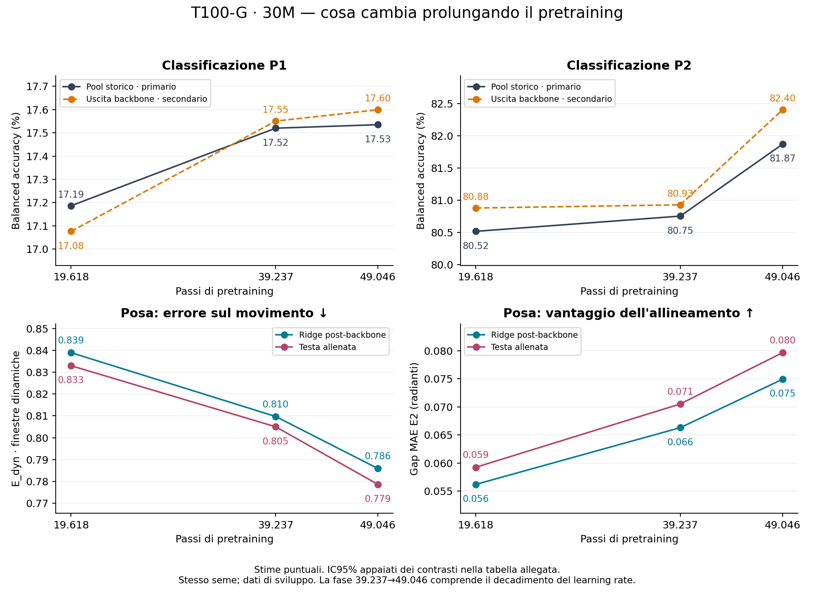

# Valutazione lunga T100-G 30M: verifica e lettura scientifica GPT

07/11/2026. Consegna di Claude `c109bfef5a3f80cc4b2334e3554c2171db938467`,
ramo `claude/consolidation-long-exec-20261105`. Il successivo `b6dfb7a` aggiunge
solo la precisazione documentale sulla riverifica del critico. Protocollo
`consolidation-long-evaluation-20261105-v1`, emendamento A1 approvato da Simone
il 06/11 alle 16:49, «Sì, approvo».

**Catena verificata sui materiali pubblicati. Il training lungo migliora la
posa, compresa la dinamica, in entrambi i pannelli primari. Il beneficio
primario sulla classificazione resta non risolto; un contrasto secondario
post-backbone è favorevole.** Conclusioni **1–4 firmate da Simone il
07/11/2026 alle 14:54 CET**, «Sì, firmo». Il punto 5 è stato poi approvato
separatamente («Tutto, 19,6 GiB») ed eseguito da Claude; verifica locale dei
manifest descritta sotto. Il [protocollo A](../protocol_a_epn_label_efficiency_20261107.md) è affidato a GPT per la preparazione; disegno operativo e budget restano da decidere.

## Tabella aggiornata della linea 2

| Che cosa è stato fatto | Spiegazione | Risultato | Conclusione |
|---|---|---|---|
| Pretraining lungo T100-G 30M | Stessa traiettoria da 19.618 a 39.237 e 49.046 passi; l'ultimo tratto include il decadimento WSD | Tre checkpoint completi e persistenti su WORK; continuazione costata 25,283 GPUh, separata dalla valutazione | Possiamo misurare il beneficio della ricetta lunga, non isolare causalmente il solo numero di passi dal decadimento |
| Classificazione con pool storico, primario | Encoder congelato e sonde convergenti; P1 su DB2/DB3/DB6, P2 su EPN/UCI | 49k−19k: P1 +0,35 pp [−0,22; +0,91]; P2 +1,35 pp [−0,13; +2,71] | Nessun beneficio pratico congiunto dimostrato secondo V-R1; riferimento esplorativo 19.618 |
| Sonde a due livelli | Stesso forward, larghezza 384 e ricetta di lettura pre/post backbone | Post supera pre a tutte le dosi su entrambi gli indici; post49k−19k P2 +1,52 pp [+0,27; +2,89], P1 non inferiore | Il backbone migliora l'accessibilità al lettore; il secondario positivo non sostituisce il primario |
| Posa: ridge dopo il backbone, primario | Encoder congelato, lettore selezionato sul train, valutazione sugli stessi 15 utenti held | E_dyn dinamiche 0,839→0,786: riduzione 6,32% [5,87; 6,83]; aumenta il gap E2 | Miglioramento pratico della rappresentazione accessibile alla ridge, oltre alla postura media |
| Posa: testa allenata, primario separato | Testa già nel teacher, senza nuovo adattamento; identico supporto crop6 | E_dyn dinamiche 0,833→0,779: riduzione 6,52% [5,92; 7,15]; aumenta il gap E2 | Conferma coerente sul lettore addestrato con il FM; riferimento esplorativo 49.046 per la posa |
| EPN15, già chiuso | FT e scratch a 15 epoche partono dalle inizializzazioni prescritte; FT usa il teacher a 19.618 | FT−scratch +0,83 pp [0,42; 1,26]; vantaggio minore che a cinque epoche | Beneficio modesto del pretraining in questa pipeline; non è un test del fine-tuning del checkpoint lungo |

Le barre d'incertezza non sono dedotte dal grafico: gli IC dei contrasti sono
appaiati per soggetto. Tutti i contrasti congelati sono riportati
[nell'appendice numerica](../../results/infra/consolidation_long_20261105/gpt_review_20261107/prespecified_contrasts.md),
anche quando piccoli o non risolti. [Dati aggregati della figura](../../results/infra/consolidation_long_20261105/gpt_review_20261107/scientific_readout.json).

## 1. Verifica a posteriori della catena

Verifica esclusivamente locale: Git, ricevute, log, copie del ledger e sacct
raccolti dall'operatore. Nessun accesso operativo al cluster, nuovo input,
fit, inferenza, rilancio, deployment o monitor. Nessuna modifica ai piani
eseguiti o ai sorgenti runtime.

| Fase | Allocazioni, checkout incluso | SHA congelato | GPUh | Coreh |
|---|---:|---|---:|---:|
| Estrazioni | 13 | `7d276c9` | 3,373611 | 27,001667 |
| Benchmark | 17 | `166fb86` | 0 | 15,217222 |
| Fit | 73 | `a70e29e` | 0 | 134,265000 |
| Confronti e sintesi | 4 | `d751063` | 0 | 0,261111 |
| Totale | **107** | quattro checkout | **3,373611** | **176,745000** |

Confermati i tetti 9 GPUh / 1.711,666667 coreh. Questi consumi non comprendono
il pretraining lungo né EPN15. Le proiezioni prudenti dei fit erano molto
maggiori del consumo; nessun limite è stato modificato dopo aver visto gli score.

Controlli confermati:

- 107 ID e allocazioni distinti, tutti COMPLETED 0:0, un tentativo per ID;
  107 stati archiviati uguali al ledger locale corrente, 107 log e 103 ricevute.
  Sacct contato sulle sole allocazioni, senza `.batch`/`.extern`.
- Codice e piano di ogni fase uguali ai pin; ricetta scientifica
  `b2356a8e…` invariata. Source `1ca7aead…` per extract/benchmark e
  `77e09626…` per fit/aggregate, col ponte A1 chiuso e verificato, non con
  accettazione generica di hash diversi. I 103 file scientifici pertinenti
  restano byte-identici fra le fasi.
- Pin delle 21 cache; identità e parità storica documentate nelle estrazioni.
  Copertura 69 shard di classificazione = 40 celle nuove × quattro fold,
  nessun fold duplicato, nessun nuovo fit 19k/pool; tre fit posa completi.
- Contesto numerico nuovo unico e regola B verso lo storico; `exact_match`
  resta falso per gli OpenMP aggiuntivi del processo che importa Torch.
  Compatibilità verificata non significa identità bit per bit dei fit.
- Due confronti completi, summary completa; hash e dimensione del piano
  esterno `f7728778…`, wrapper `34ba86c7…` e `script_stdin_sha256` del ledger
  coincidenti. Il quarto checkout è riusato: nessun quinto checkout.

I campi `checkpoint_unchanged=false` delle ricevute CPU sono valori dello
schema per fasi che non caricano il modello, non esiti di mutazione dei pesi.
Le estrazioni hanno i propri controlli di checkpoint e teacher immutati.

**Limiti della verifica:** non ho riaperto i payload NPZ o i checkpoint remoti.
Gli hash dei payload sono verificati nella catena delle ricevute e negli audit
dell'operatore, non nuovamente sui byte in SCRATCH. La summary incorpora i due
report: ricostruiti byte-identici alle copie delle ricevute. Incorpora anche
il contenuto completo di `comparison.json` classificazione; l'ordine originale
delle chiavi è perso, quindi non dichiaro di aver ricostruito il suo bytehash
`0382f010…` dalla riserializzazione. Questo non impedisce il ricalcolo numerico
indipendente del contenuto pubblicato.

## 2. Classificazione: primario incerto, secondari informativi

| Vista | P1 a 19.618 | P1 a 39.237 | P1 a 49.046 | P2 a 19.618 | P2 a 39.237 | P2 a 49.046 |
|---|---:|---:|---:|---:|---:|---:|
| Pre-backbone, 384 | 15,37% | 15,44% | 16,02% | 78,29% | 78,77% | 78,50% |
| Post-backbone, 384 | 17,08% | 17,55% | 17,60% | 80,88% | 80,93% | 82,40% |
| Pool storico, 768 | 17,19% | 17,52% | 17,53% | 80,52% | 80,75% | 81,87% |

Pre è l'uscita del Perceiver, dopo tokenizer ed encoder locale; post comprende
il backbone e la sua normalizzazione finale. Il pool storico concatena post
e componente locale, **non pre e post**. P1/P2 sono indici su popolazioni e
compiti differenti: i loro valori assoluti non misurano la stessa difficoltà.

V-R1 richiede almeno 1 pp con IC favorevole su un indice e non inferiorità a
−1 pp sull'altro. Nel primario pool49k−19k gli IC includono zero su entrambi
gli indici: il requisito di beneficio non è soddisfatto. Sono invece sostenute
le non inferiorità al margine −1 pp. Non segue equivalenza, né assenza di
qualsiasi beneficio. I contrasti pool39k−19k e pool49k−39k sono anch'essi piccoli
o non risolti. La regola mantiene 19.618 come riferimento della classificazione.

Nella vista post, 49k−19k dà P2 **+1,52 [0,27; 2,89] pp**, P1
**+0,52 [−0,09; 1,15] pp**; il secondo indice è non inferiore. Anche post49k−39k
è favorevole secondo la regola. È un risultato secondario previsto, utile;
non lo promuoviamo a primario dopo averlo visto. Il confronto post−pre è
positivo a tutte e tre le dosi su P1/P2 a dimensione e lettore uguali. Questo
sostiene una migliore accessibilità dopo il backbone; non misura tutta
l'informazione nei tensori, né dimostra che il backbone conservi ogni dettaglio.

| Dataset, primario pool49k−19k | Soggetti | Delta pp [IC95%] |
|---|---:|---:|
| EPN612 | 314 | +1,93 [1,42; 2,44] |
| UCI | 19 | +0,77 [−2,14; 3,48] |
| NinaPro DB2 | 32 | +0,84 [0,04; 1,63] |
| NinaPro DB3 | 8 | −0,49 [−1,11; 0,05] |
| NinaPro DB6 | 8 | −0,35 [−2,45; 1,58] |

EPN migliora chiaramente, ma P2 pesa EPN e UCI per metà ciascuno: la scarsa
precisione di UCI conta. P1 pesa DB2/DB3/DB6 per 8/13, 3/13, 2/13.
Non c'è un beneficio uniforme fra dataset e non si sostituisce il solo EPN
alla domanda prespecificata. Sono popolazioni di sviluppo, non una nuova
valutazione ufficiale di trasferimento su tutti soggetti mai visti nel pretraining.

Replica storica T25-L−B19618, appaiata e descrittiva: **P1 +0,510
[0,090; 0,926] pp; P2 −0,093 [−1,382; 1,065] pp**. Si riporta accanto ai nuovi
contrasti; non è un pavimento universale del rumore e non si sottrae ai delta.

## 3. Posa: due primari concordi sul movimento

E_dyn è la MSE temporale centrata divisa per la varianza centrata dei bersagli;
è adimensionale e più basso è meglio. Il riferimento 1 corrisponde a nessuna
variazione temporale nella predizione dopo il centraggio. La metrica rimuove
il livello medio per finestra/giunto; il livello è misurato separatamente.

| Misura sulle finestre dinamiche | Ridge post 19k | Ridge post 39k | Ridge post 49k | Testa 19k | Testa 39k | Testa 49k |
|---|---:|---:|---:|---:|---:|---:|
| E_dyn ↓ | 0,839 | 0,810 | 0,786 | 0,833 | 0,805 | 0,779 |
| Correlazione centrata ↑ | 0,401 | 0,436 | 0,463 | 0,410 | 0,443 | 0,471 |
| Varianza predetta / bersaglio | 0,169 | 0,199 | 0,221 | 0,192 | 0,229 | 0,239 |
| MSE del livello medio ↓ | 0,551 | 0,521 | 0,493 | 0,545 | 0,516 | 0,481 |

| Contrasto dinamiche, riduzione relativa E_dyn | Ridge post [IC95%] | Testa allenata [IC95%] |
|---|---:|---:|
| **49.046−19.618, primari** | **6,32% [5,87; 6,83]** | **6,52% [5,92; 7,15]** |
| 39.237−19.618 | 3,48% [3,03; 3,93] | 3,36% [2,75; 3,89] |
| 49.046−39.237 | 2,94% [2,62; 3,30] | 3,28% [2,84; 3,70] |

Entrambi superano il criterio pratico congelato (2% relativo, IC favorevole),
anche nei due segmenti secondari. Descrittivamente, E_dyn migliora in tutti
i 15 utenti in entrambi i primari; mediane individuali 6,20% e 6,25%.
Il livello migliora contemporaneamente: delta MSE −0,0585 [−0,0757; −0,0417]
nella ridge e −0,0642 [−0,0816; −0,0464] nella testa. Non è soltanto una
migliore stima della postura media.

Anche E2, confronto fra bersagli allineati e disallineati sul medesimo supporto,
è coerente. Le unità qui sono **radianti**, non MSE standardizzata:

| E2 | Ridge post | Testa allenata |
|---|---:|---:|
| Gap disallineato−allineato a 19k | 0,05620 | 0,05924 |
| Gap a 49k | 0,07491 | 0,07964 |
| Aumento appaiato del gap [IC95%] | +0,01871 [0,01620; 0,02088] | +0,02040 [0,01759; 0,02310] |
| Delta MAE allineata, 49k−19k [IC95%] | −0,02016 [−0,02420; −0,01625] | −0,02178 [−0,02670; −0,01689] |
| Delta MAE disallineata [IC95%] | −0,00145 [−0,00443; 0,00181] | −0,00137 [−0,00519; 0,00318] |

Il gap aumenta perché migliora l'allineato; il cambiamento del disallineato
non è risolto. E2 da solo non isola ogni componente del movimento, ma insieme
alla metrica centrata sostiene che il miglioramento temporale è reale in
questa popolazione. Non si confronta questo E2 crop6 direttamente con l'E2
storico a supporto intero.

I gruppi non dinamici non sono nascosti: riduzione E_dyn all 5,94%/6,21%,
static 4,35%/4,88%, sempre ridge/testa e con IC favorevoli. A 49k static ha
E_dyn 0,980/0,952. Nessuna regressione chiara segnalata dalla regola su livello,
correlazione o E2. Tutti i numeri e IC sono nell'appendice.

Il controllo pre-ridge resta debole: sulle dinamiche 1,035→1,032, miglioramento
relativo 0,31%, correlazione 0,074→0,079. A 49k post−pre riduce E_dyn del
23,86% [21,83; 26,17]. La parte temporale utile è molto più accessibile dopo
il backbone con questo lettore. Non autorizza a concludere che prima del
backbone non esista informazione utilizzabile da altri lettori.

**Resta un limite sostanziale:** a 49k le predizioni hanno solo il 22–24%
della varianza temporale del bersaglio, correlazione circa 0,46–0,47 e
E_dyn circa 0,78. La rappresentazione è migliorata, ma l'inseguimento del
movimento resta incompleto. Non confondere il 6,3–6,5% di riduzione
dell'errore rispetto a 19k con una ricostruzione quasi completa del movimento.
La varianza ridotta, da sola, non dimostra un errore di scala: aumentarla
artificialmente non garantirebbe minore errore o maggiore informazione.

Supporti verificati: 18.548 finestre held, 15 utenti; 16.620 finestre con
metriche centrate valide, delle quali 8.327 dinamiche e 8.293 statiche.
E2: 7.982 finestre, 14 utenti, 16.887.760 elementi validi. Supporti e bersagli
identici fra le celle; alpha ridge 100.000 interno alla griglia dopo le
estensioni prescritte, nessun bordo irrisolto. Selezione sul train, held
aperto dopo entrambi i fit; nessun adattamento sui 15 utenti held.

## 4. Ricalcolo indipendente e limiti scientifici

Classificazione ricalcolata dai conteggi appaiati per soggetto/classe salvati
nella summary: 45 celle, 12 contrasti per dataset e per P1/P2; 2.000 repliche,
seed 20261102. Stime, IC e decisioni coincidono, scarto massimo **0,0 pp**;
hash dei cinque disegni bootstrap coincidenti, nessuna classe persa.

Posa ricalcolata dalle somme sufficienti per utente nelle tre ricevute di fit:
bootstrap indipendente con matrici di molteplicità, nessun import del progetto;
**1.683 valori confrontati**, scarto massimo **4,39×10⁻¹⁴**. Non sono state
rigenerate predizioni né ricalcolate le somme dai payload NPZ.

Gli intervalli ricampionano soggetti mantenendo fissi checkpoint e lettori:
non misurano variabilità tra semi di training. Un solo seme, utenti/dataset
di sviluppo già letti in campagne precedenti, nessun test ufficiale nuovo,
molti contrasti senza correzione della molteplicità. Il tratto 39k→49k
comprende sia nuovi aggiornamenti sia il decadimento del learning rate:
non isola il contributo causale dei due.

La posa è supervisionata durante il pretraining: il miglioramento su utenti
held è utile, ma non dimostra da solo trasferimento generale del FM a un task
mai supervisionato. La concordanza ridge/testa restringe la diagnosi:
il progresso non è spiegabile soltanto da una migliore taratura della testa
esistente, perché migliora anche la lettura delle rappresentazioni congelate.
Non dimostra però che i latenti abbiano raggiunto il proprio limite informativo.

## 5. Conclusioni 1–4 firmate; punto 5 eseguito su decisione separata

1. Chiudere questa valutazione come **eseguita e verificata**. Nessun difetto
   bloccante trovato nei materiali; non servono nuovi lanci per leggerla.
2. Per la posa adottare **49.046 come riferimento esplorativo**, mantenendo
   affiancati ridge post e testa allenata. Il training lungo ha un beneficio
   pratico concorde sul movimento, con qualità assoluta ancora limitata.
3. Per il primario di classificazione mantenere **19.618** secondo V-R1.
   Conservare e riportare il risultato secondario favorevole post-backbone
   e l'eterogeneità per dataset, senza promuovere un nuovo primario.
4. Nessuna promozione generale del FM, modifica di loss/architettura, nuova
   dose o nuovo esperimento deriva automaticamente da questa chiusura.
   EPN15 rimane una prova sul teacher19k; il fine-tuning del teacher49k non
   è stato misurato. Le decisioni successive richiedono un protocollo distinto.
5. **Non incluso nella firma delle 14:54; successivamente approvato ed eseguito.**
   Prima della purge conservare gli artefatti di audit delle predizioni,
   come dettagliato nella [nota di conservazione](consolidation_long_preservation_20261107.md);
   questa review
   non esegue trasferimenti né promette proroghe su SCRATCH.

**Firma di Simone: acquisita per le sole conclusioni 1–4.** Il 07/11/2026
alle 14:54 CET, alla domanda di Claude «Firmi le conclusioni 1-4 di GPT
(chiusura verificata, riferimenti 49.046 posa e 19.618 classificazione)?»,
Simone ha risposto: **«Sì, firmo»**. La firma riguarda il testo scientifico
pubblicato in `57c4d7ea564949cbf74506085578b77a4d033d10`.

Registrazioni verificate:

- `docs/decisioni.md`, commit `838280183e94c6fdbd9b3d87ea2b3d8ce1a3e313`
  sul ramo `claude/consolidation-long-exec-20261105`;
- `docs/claude_GPT_shared`, commit `776b401bcaaaf807541ddc818ff10ab76bfad7ef`
  sul ramo `worktree-claude-training-engine`.

La conclusione 5 non era inclusa nella firma delle 14:54. Simone ha poi
deciso separatamente, il 07/11/2026: **«Tutto, 19,6 GiB»**. Claude ha eseguito
la copia dell'intera LONG_ROOT su WORK con il job 63781257; prove in
`424f0ecc5dc23120ac84a7f2e3e1a24fede2b250`, registro
`51a611a2cac7d1b29a528f7c67a5cd1d5b130d1d`. Verifica GPT sui manifest:
354 file, 174 directory, 21.062.138.097 byte; tutti i 352 elementi del nostro
inventario presenti e identici, più piano materializzato e report finale
della sintesi. Nessuna operazione remota di GPT. Dettagli e limiti nella
[nota di conservazione](consolidation_long_preservation_20261107.md).

La successiva decisione separata «Sì, aggiungila» ha incluso T100-G 19.618:
26 file, 23.981.927 byte, copiati da Claude con il job 63785874 e verificati
sui manifest della consegna `2930d7d`; registro `9c44fbb`. La conservazione
dei due insiemi richiesti è completata. Il seguito A, curva di efficienza dei
dati, è affidato da Simone a GPT per la preparazione di un protocollo distinto;
la scelta della ricetta e del budget precede ogni eventuale invio di Claude.
Nessun nuovo esperimento deriva automaticamente dalla firma o dalla conservazione.
Le rettifiche accolte alla lettura di Claude sono registrate separatamente
in `3231062e729843e38b835919af8d1405bcd6c60d`.

## 6. Artefatti e riproducibilità

Le verifiche, gli script indipendenti, le tabelle e la figura sono pubblicati
in `results/infra/consolidation_long_20261105/gpt_review_20261107/` e
`docs/reviews/`. I file operativi originali restano nel commit immutabile di
Claude; non sono stati sostituiti o reinterpretati come nuovi pin di fase.

La lettura critica indipendente del testo e dell'appendice pubblicati in
`57c4d7e` è favorevole,
senza rilievi bloccanti; controllate anche tutte le 24 righe dell'appendice
posa. [Nota del critico](../../results/infra/consolidation_long_20261105/gpt_review_20261107/critic.txt).
Gli hash originali del critico sono conservati: gli aggiornamenti successivi
registrano firma e conservazione, senza modificare risultati o criteri scientifici.

Per riprodurre i controlli si prepara una copia locale del commit c109bfe e
si eseguono gli script `check_long_chain_20261107.py`,
`check_long_classification_20261107.py` e `check_long_pose_20261107.py`, con
`--snapshot-root` e `--out` indicati dal loro `--help`. La verifica del ledger
locale richiede anche la copia dei 107 stati. Nessuna chiamata a Leonardo.
