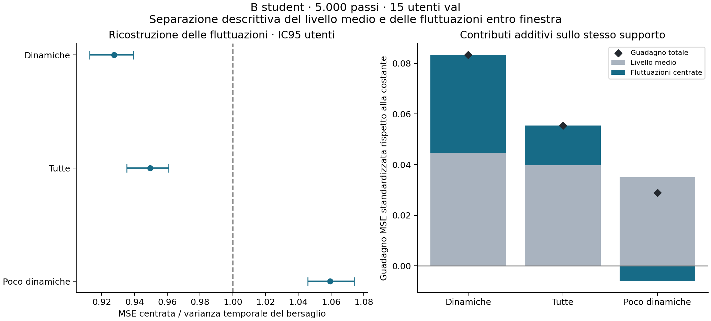

# B a 5.000: un segnale dinamico utile, ancora debole

28/10/2026, GPT. Job **62551730 COMPLETED 0:0**, 13s, **0 GPU-ore / 0,014444 core-ore**.
Metodo, source e payload pubblicati prima del lancio nel commit **dda2b1b**; [protocollo](../dinamica_b_20261028.md),
[review preventiva](dinamica_b_prereview_20261028.md),
[rapporto originale](../../results/infra/pilot_posa/b_dynamics_20261028/final/report.json).

**La testa non apprende soltanto il livello medio della posa. Sulle finestre dinamiche predice una parte delle variazioni
entro finestra, con un beneficio modesto e coerente fra utenti. Sulle finestre poco dinamiche, invece, le variazioni
predette peggiorano la ricostruzione rispetto alla traiettoria centrata piatta.**

## Lettura primaria, fissata prima del calcolo

8.329 finestre dinamiche / 15 utenti esclusi dal training / 21.750.080 elementi validi. In questo gruppo il supporto n>=2
coincide con quello della metrica totale; nessun giunto o utente e' stato eliminato in funzione del risultato.
Le unita' sono **MSE standardizzata**, non MAE in radianti.

| Misura | Risultato |
|---|---:|
| Varianza temporale dei target, errore della baseline centrata nulla | 0,533503 |
| MSE delle traiettorie centrate | 0,494811 |
| Rapporto MSE centrata / baseline | **0,927475**, IC95 **[0,912480; 0,939174]** |
| Riduzione relativa dell'errore centrato | **7,252%**, IC95 **[6,083%; 8,752%]** |
| Guadagno assoluto sulla dinamica | **0,038692**, IC95 **[0,031890; 0,047288]** |
| Utenti con guadagno dinamico positivo | **14/15** |
| Varianza temporale delle predizioni | 0,033739 |
| Rapporto varianza predetta / target | **0,063240** |
| Correlazione pooled delle traiettorie centrate | **0,269936** |

L'utente con guadagno negativo e' `ab228f34a5`, che ha soltanto 7 finestre dinamiche. E' incluso secondo il protocollo;
non viene eliminato per migliorare l'esito. I segni individuali non sono test di significativita' per soggetto.
Gli IC ricampionano gli utenti con le loro somme e pesi appaiati (1.000 repliche, seed20261009); il ricalcolo indipendente coincide.

Il rapporto di varianze indica oscillazioni predette ancora piccole. La radice del rapporto vale circa 0,2515: e' il
rapporto fra RMS delle deviazioni centrate aggregate, non una stima di un fattore di scala unico per ogni traiettoria.
Non giustifica moltiplicare le uscite: una previsione attenuata puo' riflettere informazione incompleta e amplificarla
puo' amplificare anche l'errore. Non sono stati fittati guadagni, lag o altre correzioni su val.

## Da dove viene il miglioramento della MSE

Sullo stesso supporto dinamico, la scomposizione e' esatta:

| Componente | Costante del train | Predizione B | Guadagno assoluto |
|---|---:|---:|---:|
| Livello medio per finestra/giunto | 0,678382 | 0,633742 | **0,044640** |
| Variazioni intorno alla media | 0,533503 | 0,494811 | **0,038692** |
| **Totale** | **1,211885** | **1,128553** | **0,083332** |

Il guadagno sulle variazioni e' quindi apprezzabile rispetto a quello sul livello medio in questo gruppo, anche se piccolo
rispetto alla varianza temporale totale. Questa e' una scomposizione dell'errore, non una spiegazione causale dei meccanismi
dell'encoder. Non si confonde con la scomposizione dell'energia delle predizioni osservata in B.

Centrare **entrambe** le traiettorie concede una correzione perfetta del bias per finestra/giunto: il rapporto centrato
descrive la qualita' delle fluttuazioni dopo tale correzione. Non significa che il modello operativo batta una baseline
che conosce la media vera del bersaglio; il suo errore totale include ancora il termine delle medie. Per questo i tre
termini vengono riportati insieme. Il riferimento centrato e' un oracolo diagnostico, non un predittore utilizzabile in uso.

## Secondari predefiniti: beneficio non uniforme rispetto alla dinamica del target

| Gruppo | Finestre con n>=2 | Rapporto centrato [IC95] | Variazione errore | Utenti con guadagno positivo |
|---|---:|---:|---:|---:|
| Dinamiche, primario | 8.329 | 0,927475 [0,912480; 0,939174] | **−7,252%** | 14/15 |
| Tutte, secondario | 16.658 | 0,949514 [0,935137; 0,960796] | −5,049% | 14/15 |
| Poco dinamiche, secondario | 8.329 | **1,059447 [1,045879; 1,074216]** | **+5,945%** | **0/15** |

Sulle poco dinamiche il guadagno sul livello medio e' +0,034997, quello sulla dinamica **−0,006070**, lasciando un guadagno
totale +0,028927. La testa migliora la postura media ma introduce variazioni che ne erodono una parte del beneficio.
Non chiamiamo queste finestre «immobili»: sono la meta' con varianza del target inferiore alla mediana, secondo la definizione E1.

Su tutte le finestre, guadagno medio +0,039707 e dinamico +0,015793, totale +0,055500 sul supporto n>=2.
Le 26 finestre con una sola patch valida restano nel riepilogo totale n>=1, non nella dinamica. Sono 16.684 finestre con
supporto n>=1, 16.658 con supporto n>=2 e 18.548 estratte complessivamente. Nessun cambiamento della selezione E1.

## Diagnosi aggiornata e conseguenze

L'ipotesi «si impara soltanto la postura media» e' ora troppo forte: il vantaggio sulle variazioni e' osservabile anche
eliminando le medie, su utenti esclusi dal training. Rimangono una dinamica debole e attenuata e un peggioramento nella
componente temporale delle finestre poco dinamiche. Non c'e' ancora evidenza di un buon inseguimento del movimento.

B e queste letture sostengono il problema di dose del dbg (H1) e indeboliscono l'assenza assoluta di informazione utile
alla posa (H2). Non identificano quanto del limite restante dipenda dall'encoder, dalla testa, dall'obiettivo o dai dati,
ne' garantiscono che passare a 49.046 risolva il problema. Il risultato non richiede di riparare la catena dei bersagli o
di cambiare pooling, scala delle uscite o loss sulla base di val.

Se si prosegue la diagnosi del limite encoder/testa, il confronto E3 sui latenti B con selezione della ridge soltanto
nel train resta il passo pertinente; la cache val e' gia' disponibile. E3 non sostituirebbe questa lettura della dinamica,
e un confronto con R0 va tenuto a pari protocollo e lettore. Nessun altro job e' stato lanciato in questa consegna.
R3 completo rimane una decisione scientifica distinta; la nuova autonomia sui piccoli job non cambia questo risultato in un via automatico.

## Verifiche e consuntivo

SHA della cache, source, payload e riferimenti concordi con il piano. Il nuovo programma riproduce E1 dinamiche, relativo
bootstrap e valori per utente: rapporto float64 0,937551812037 contro 0,937551812385 del report precedente float32,
entro rtol1e-6/atol1e-8. Le identita' MSE e dei guadagni hanno residuo massimo inferiore a 6,4e-14.
Questa lettura chiude anche il limite del JSON E1 precedente, che da solo non consentiva di ricostruire il pooling.

18 test sintetici pre-lancio passati; review scientifica e tecnica favorevoli, ricalcolo indipendente degli IC dai risultati.
Il job ha usato source SHA256 `5e5ff2c8b27d5692a064534f793924ddf5463c7bab13ccf75356c0950d9dd5b8`,
payload `288d76a289435550983055e3e35a5084e57c7ca0053c5bf12efb569c36a7ac2f`; checkpoint/cache immutati.
Il checkout `24139ab` ha fornito l'ambiente, non viene indicato come versione del nuovo programma di analisi.

SLURM: 28/10/2026 **12:30:59–12:31:12 Europe/Rome**, 13s, 4 CPU, 16GB richiesti; MaxRSS batch 0,586GiB,
TotalCPU 8,770s. **0 GPU-ore e 0,014444 core-ore**, entro il tetto 0,666667 core-ore. Nessuna nuova inferenza, estrazione,
modifica dei checkpoint o retry. Il ritardo prima della sottomissione riguardava il permesso del comando nell'app,
non la coda o un errore del job. Report, log e provenienza sono pubblicati nel ramo GPT insieme al registro.
