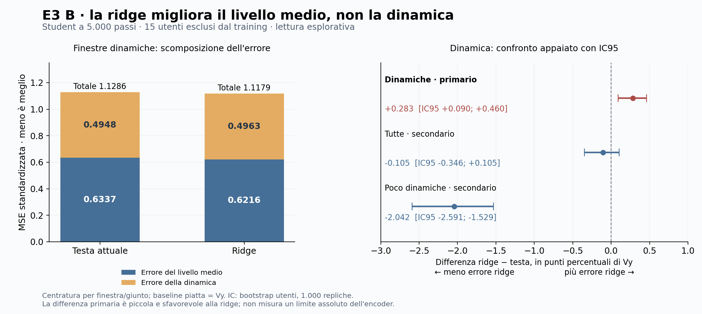

# E3 B a 5.000 passi: risultati, modifiche e quadro complessivo

28/10/2026. Protocollo/codice congelati in `520158e`, registrazione dei lanci in `28695c1`.
**Entrambi i job sono completati. Questo rifit ridge non recupera ulteriore dinamica rispetto alla testa attuale:
il primario e' leggermente peggiore. Migliorano invece il livello medio della posa e la MSE totale.**
Nessun nuovo training o verdetto finale sul pilot R3 deriva da questa lettura.

## Esecuzione e controlli

| Job | Attivita' | Esito | Durata | GPU-ore | Core-ore |
|---|---|---|---:|---:|---:|
| 62561780 | Estrazione train B student | COMPLETED, 0:0 | 4 min 15 s | 0,070833 | 0,566667 |
| 62561881 | Fit ridge e rapporto, afterok | COMPLETED, 0:0 | 1 min 46 s | 0 | 0,235556 |
| Totale | | | | **0,070833** | **0,802222** |

Tetti: 0,333333 GPU-ore / 6,666667 core-ore. Fine rapporto alle 14:27:32 Europe/Rome, coda vuota
alla raccolta delle 14:45. Nessun retry. Checkpoint, cache val e codice di campagna invariati.

- Train: 40 utenti, 200 registrazioni richieste, 1.907 finestre e 260.163 istanti validi per giunto.
  Finestre/stem identici al subset R3c. Zero righe parzialmente valide su train e val.
- M2 superato: massimo errore assoluto train 0,00010318 / val 0,00011572;
  RMSE train 0,00001547 / val 0,00001551. Tolleranze preventive per blocco: 0,005 / 0,0005.
- Alpha scelto esclusivamente fra utenti train: **10^6**, minimo interno alla griglia finale 10^-2..10^7;
  MSE interna 0,891605; nessun bordo irrisolto. Alpha usa SSE non normalizzata: il suo valore
  numerico non e' confrontabile direttamente con fit di diversa numerosita' o scala delle feature.
- Ricostruzione dei momenti e conteggi della testa concorde con il precedente rapporto dinamico.
  I 41 test CPU erano passati prima dei job. Review scientifica e tecnica preventive favorevoli.
- Ricalcolo indipendente dei tre delta e IC dai momenti per utente: concorde entro 1e-12;
  seconda lettura indipendente del critico concorde sul primario, sui supporti e sui limiti.
  Letta senza merge anche la nota informale di Claude `7a4221d`: primario e consuntivo concordano.

## Risultato scientifico

Il rapporto centrato e' l'errore sulle variazioni entro finestra, dopo aver sottratto separatamente
la media della predizione e del target, diviso per la varianza temporale del target sullo stesso supporto.
**1 = previsione piatta dopo centratura; meno di 1 = beneficio dinamico.** La centratura usa il target:
e' una separazione descrittiva dell'errore, non una correzione utilizzabile in produzione.

| Gruppo | Testa: errore centrato / Vy | Ridge: errore centrato / Vy | Delta ridge − testa, IC95 |
|---|---:|---:|---:|
| Dinamiche, primario | **0,927475** | **0,930307** | **+0,002832 [+0,000898; +0,004602]** |
| Tutte, secondario | 0,949514 | 0,948463 | −0,001051 [−0,003465; +0,001053] |
| Poco dinamiche, secondario | 1,059447 | 1,039027 | −0,020421 [−0,025914; −0,015292] |

Primario: 8.329 finestre, 15 utenti esclusi dal training, 21.750.080 elementi validi.
Bootstrap appaiato per utente, 1.000 repliche, seme 20261009. Beneficio dinamico della testa **7,2525%**,
della ridge **6,9693%**. Differenza sfavorevole alla ridge **0,2832 punti percentuali di Vy**,
IC95 [0,0898; 0,4602]: effetto piccolo; peggioramento in 10 utenti, miglioramento in 5.
Le due letture migliorano sul piatto in 14/15 utenti. Questi conteggi rispondono a confronti diversi.

| Finestre dinamiche, MSE standardizzata | Testa | Ridge | Delta ridge − testa |
|---|---:|---:|---:|
| Errore del livello medio | 0,633742 | 0,621616 | −0,012126 |
| Errore delle variazioni centrate | 0,494811 | 0,496321 | +0,001511 |
| Errore totale | 1,128553 | 1,117938 | −0,010615 |
| Varianza predetta / target | 0,063240 | 0,044025 | −0,019215 |
| Correlazione centrata pooled | 0,269936 | 0,270988 | +0,001051 |

La ridge migliora la MSE totale tramite la postura media, mentre la dinamica peggiora lievemente.
Produce traiettorie ancora piu' attenuate; la piccola differenza di correlazione non e' una dimostrazione
di equivalenza. Sulle poco dinamiche riduce l'errore rispetto alla testa in 15/15 utenti,
ma entrambe restano peggio del piatto. Su tutte le finestre il confronto centrato e' inconcludente.

E1 MAE dinamiche, secondario descrittivo: testa/costante 0,937552, ridge/costante 0,941109.
Non e' la stessa metrica della MSE centrata e non si applica il criterio finale E1 a 5.000 passi.
La costante del subset non migliora il riferimento globale (rapporto MAE 1,001251): non e' emersa
una correzione utile della sola costante. I momenti centrati di questa previsione costante,
dell'ordine di 1e-32, sono arrotondamento numerico e non movimento o danno reale.

**Conclusione consentita:** questa ridge, sulle feature della testa e con questo disegno di fit,
non legge piu' dinamica della testa esistente. Il risultato riduce la motivazione per un semplice
rifit lineare come soluzione immediata. Non dimostra saturazione dell'encoder, ottimalita' della testa,
equivalenza fra lettori o necessita' automatica di altro training. Fit su subset, obiettivo di selezione
MSE totale, regolarizzazione, vista unmasked e feature finali fisse restano diversi dal training della testa.
Non si riottimizza ora il lettore sul gruppo dinamico della val gia' osservata.

## Elenco delle modifiche richieste e loro stato

| Punto discusso con Claude | Decisione e verifica |
|---|---|
| M1: feature dopo LayerNorm | Implementato con gamma/beta del checkpoint ed eps della classe congelata |
| M2: testa ricostruita dalla cache | Implementato, tolleranze preventive rispettate su train e val |
| M3: maschere per giunto | Implementata la gestione generale; rettificata la diagnosi di contaminazione precedente: zero righe parziali, patch invalide gia' escluse |
| M4: griglia alpha e selezione | Implementate estensioni train-only e MSE mascherata su due fold utenti; minimo interno a 10^6 |
| Tutti gli istanti validi | Fatto, 260.163 per giunto nel fit train |
| Media per giunto del subset | Calcolata e valutata come costante secondaria |
| Stem/finestre identici a R3c | Verificato esattamente |
| Curva 20/40 e replica legacy | Escluse deliberatamente da questa tranche, come scritto prima del lancio |
| Riscalatura delle uscite | Ricalcolo fatto: recupero globale ideale di appena 0,0341 punti percentuali di Vy sulle dinamiche; nessuna scala applicata |
| Confronto appaiato e scomposizione | Implementati e letti; IC che contiene zero significa inconclusivo, non equivalenza |
| Media sui canali | Nessun ripristino necessario: resta nel readout ufficiale; la posa media i K latenti per istante e preserva il tempo |
| Ruoli | GPT implementa e lancia; Claude rivede. Worktree separati, consegne pubblicate su origin |
| Continuazione a 19.618 | Non avviata; criteri della proposta precedente da riformulare, confronto effettivo con R3c da verificare |
| R3 a 49.046, E3 R0, J2 bis | Non avviati in questa tranche; R0/J2 bis rimangono secondari |

## Dove siamo e come proseguire

1. **Dati e bersagli:** i controlli svolti non hanno trovato un difetto nella catena. Il campione
   verificato non certifica universalmente i dati o il ritardo fisiologico.
2. **Apprendimento:** B ha superato il suo criterio train (MSE −11,713%). La dose troppo breve del dbg
   resta una spiegazione sostenuta; non e' un confronto causale della sola durata.
3. **Utenti esclusi:** E1 migliora il MAE dinamico del 6,245%; E2 mostra associazione al segnale allineato.
   La separazione dell'errore conferma un beneficio sul movimento, modesto, oltre al livello medio.
4. **Lettore:** amplificazione globale e rifit ridge non hanno risolto il limite dinamico osservato.
   La testa non appare grossolanamente sotto-ottimizzata in un modo rimediabile da queste due operazioni.
5. **Foundation model:** resta la domanda decisiva. Migliorare la posa non dimostra che la supervisione
   produca rappresentazioni migliori per altri task/dataset. Serve il confronto attribuibile R3/R3c.

La prossima proposta che raccomando di preparare e' **un punto intermedio a 19.618**, mantenendo
la ricetta di B per misurare l'evoluzione e confrontarla con R3c. E' una proposta motivata dai risultati,
non una conseguenza obbligata di E3. Prima occorrono: verifica di config, stream e schedule per precisare
quanto sia realmente abbinato il confronto; preservazione immutabile del checkpoint B5000;
differenze appaiate B19618−B5000 per E1 e dinamica; E2 come controllo di associazione;
P1/P2 contro R3c e lettore della posa con trasformazione comune ai due encoder, definita sul train.
R3c non ha la LayerNorm della testa di B: non si trasferisce automaticamente questo E3 post-LayerNorm.
Se le dosi non sono confrontabili, dichiarare il limite o correggere il disegno prima di spendere.

La precedente stima di Claude, circa 13 GPU-ore di continuazione, e' indicativa: mancano preventivo
definitivo e protocollo riformulato. Non si adottano le vecchie regole «E1 >=0,92 = plateau»,
«IC separati sovrapposti = equivalenza», «E2 deve crescere» o «nessun danno significativo = nessun danno».
Non e' stato lanciato altro e non e' richiesto un nuovo via per le attivita' E3 gia' autorizzate e concluse.

## Richiamo della lista operativa unica in sei punti

Numerazione storica conservata; i risultati E3 aggiornano il punto 5, non chiudono il progetto.

| N. | Punto | Stato al presente consuntivo |
|---|---|---|
| 1 | Confronti 2A/2C | Chiusi; risultati primari negativi, rami fuori dal default |
| 2 | Baseline encoder casuale | Chiusa nel perimetro Step 1 a 4.000 passi; risultato non trasferibile automaticamente al corpus intero |
| 3 | Review e integrazione su main | Aperta: consegne sui rami, main verificato ancora a 4680617; nessun merge in questa tranche |
| 4 | Monitor e stabilita' | Chiuso per la finestra 1; stabilita' numerica non dimostra qualita' delle rappresentazioni |
| 5 | Validare l'obiettivo scientifico | Aperto: B, E1/E2, scomposizione ed E3 conclusi; utilita' e attribuzione FM ancora da dimostrare |
| 6 | Chiudere la finestra 1 | Sospeso; scaling non giustificato dall'esito di E3 |

## Evidenze riproducibili

- [Rapporto originale](../../results/infra/pilot_posa/b_e3_20261028/final/report.json),
  SHA256 `761276493751bcb959fa0a49efa0a51da825b8730bc6d6125b95eb1164770c94`.
- [Manifest della raccolta](../../results/infra/pilot_posa/b_e3_20261028/final/collection_manifest.json),
  [consuntivo](../../results/infra/pilot_posa/b_e3_20261028/final/accounting.json), log e provenienze nella stessa cartella.
- [Ricalcolo indipendente](../../results/infra/pilot_posa/b_e3_20261028/independent_recalculation.json)
  e [script della figura](../../results/infra/pilot_posa/b_e3_20261028/present_results.py), senza import del codice sperimentale.
- [Risposta alla review](risposta_review_claude_e3_b_20261028.md), [protocollo congelato](../e3_b_20261028.md),
  [sintesi scientifica](sintesi_scientifica_20261028.md).

Cache di biosignali/latenti/predizioni e checkpoint restano sul cluster; qui solo risultati aggregati, log e provenienze.
