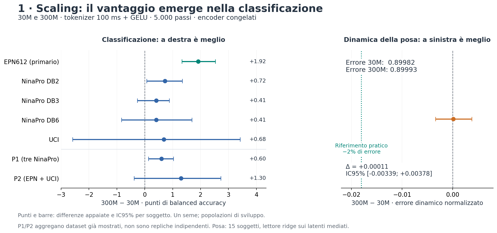
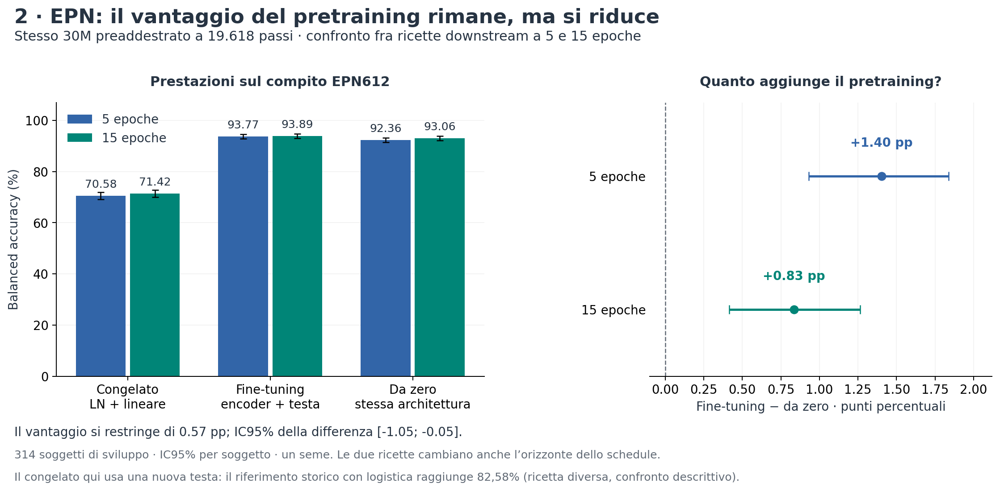

# Tracce 1 e 2: risultati, limiti e prossime domande — 06/11/2026

Sintesi GPT coordinamento richiesta da Simone. Fonti pubblicate fino alle17:31 CET,
lette localmente dopo fetch; non è una nuova lettura della coda. Nessun fit, training,
accesso operativo a Leonardo o modifica dei protocolli. Grafici generati da aggregati
già verificati: `results/infra/scaling_consolidation_synthesis_20261106/data.json`
contiene valori completi, SHA dei commit, percorsi e SHA256 delle fonti.

**Due risultati positivi, con portata diversa:** il 300M migliora la classificazione
a5.000 passi; su EPN il pretraining conserva un vantaggio nel fine-tuning a15epoche.
La dinamica della posa non migliora passando a300M a questa dose. Gli esiti del
pretraining lungo e del nuovo fine-tuning su più dataset restano da misurare.

## 1 — Scaling: il risultato a5.000 è completo

Teacher30M e300M, tokenizer100ms+GELU, stessa ricetta, stessi5.000update e160.000
finestre globali. Lettori su encoder congelati. Balanced accuracy in percentuale,
delta in punti percentuali; intervalli appaiati al95% per soggetto.

| Confronto | 30M | 300M | Delta e IC95% |
|---|---:|---:|---|
| EPN612, primario |76,31|78,23|+1,92 [1,33;2,53]|
| NinaPro DB2 |16,17|16,89|+0,72 [0,07;1,34]|
| NinaPro DB3 |2,12|2,53|+0,41 [−0,27;0,88]|
| NinaPro DB6 |31,98|32,40|+0,41 [−0,83;1,69]|
| UCI |78,63|79,31|+0,68 [−2,59;3,42]|
| P1, indice dei tre NinaPro |15,36|15,96|+0,60 [0,13;1,03]|
| P2, media EPN/UCI |77,47|78,77|+1,30 [−0,38;2,72]|

Il segnale più chiaro è EPN, con piccolo sostegno anche da DB2/P1. UCI, DB3 eDB6
restano incerti; DB3 è vicino al riferimento casuale di1/49. P1/P2 hanno compiti
diversi e P2 contiene EPN: non sono repliche indipendenti né livelli assoluti
direttamente confrontabili. La non inferiorità P1/P2 rispetto al margine−1pp è
sostenuta; su P2 la superiorità resta irrisolta.

La dinamica della posa misurata dalla ridge sui latenti mediati rimane ferma:
E_dyn0,899816→0,899931; delta+0,000115 [−0,003387;+0,003778], minore è meglio.
E_dyn≈0,90 equivale a circa10% meno errore centrato rispetto a una previsione
senza variazioni temporali. Il delta è minuscolo rispetto al riferimento pratico
prespecificato del2% (~0,018). Questo limite riguarda dose, modelli e lettore
osservati; non esclude informazione dinamica altrove nei latenti.

Comprimendo con proiezione casuale fissa le feature300M da1.792 a768 ingressi,
EPN diventa76,19%, delta−0,12 [−0,68;+0,40] rispetto al30M. Il vantaggio non
sopravvive chiaramente a questa compressione. La rappresentazione completa conta;
il controllo non separa causalmente capacità del lettore e informazione eliminata.

Il300M richiede circa3,78volte il tempo del trainer a esposizione uguale:
4,31GPUh nel30M contro16,29 nel300M, su4GPU; esclusi overhead ed evaluation.
È evidenza favorevole allo scaling classificativo, non alla sua efficienza a
parità di costo, né una ragione sufficiente per sostituire ogni30M col300M.

Esito tecnico accettato,28controlli e112confronti numerici indipendenti.
Fonti: Claude7fdb2e8, review scientifica GPT5e15009. **La continuazione300M a19.618
è stata successivamente approvata da Simone**, registrata in2d58e98: il vecchio
`continuation_authorized:false` del report fotografa la decisione precedente.
Claude prepara piano/implementazione; seguono review, ripresa e valutazioni
contro30M alla stessa dose. Nessun risultato19.618 del300M nelle fonti lette.

## 2 — Fine-tuning: il pretraining aiuta, ma il beneficio si restringe

Stesso teacher30M T100-G a19.618passi di pretraining in entrambe le ricette.
EPN escluso dal pretraining;314soggetti di sviluppo,47.100finestre,6classi,
quattro fold separati per soggetto. Le5 e15epoche sono ricette downstream
riavviate dalle inizializzazioni originali, con diverso orizzonte del coseno.

| Pipeline |5epoche|15epoche|Delta15−5, pp [IC95%]|
|---|---:|---:|---|
| Congelato, nuova testa LN+Linear |70,58%|71,42%|+0,85 [0,64;1,04]|
| Pretraining + fine-tuning |93,77%|93,89%|+0,13 [−0,19;0,45]|
| Stessa architettura da zero |92,36%|93,06%|+0,70 [0,29;1,09]|

FT−scratch passa da+1,40pp [0,93;1,84] a**+0,83pp [0,42;1,26]**.
La differenza dei vantaggi è−0,57pp [−1,05;−0,05]: sostegno a un restringimento,
con limite superiore vicino a zero. Scratch recupera parte del distacco; a15 resta
un beneficio modesto del pretraining in queste pipeline. Non è provata la
convergenza di FT, né che scratch lo raggiungerebbe con altre epoche.

Questo risponde al dubbio sulle sonde: l'architettura è addestrabile sul compito
EPN anche quando una testa congelata rende poco. Il grande contrasto FT−frozen
non è però il guadagno del pretraining: per quello conta FT−scratch. Inoltre
la logistica congelata storica otteneva82,58%, molto più della nuova testa71,42%.
Il frozen debole non dimostra un limite generale delle feature; i lettori sono diversi.

I LR sono scelti in validation fra due candidati per pipeline: stesso LR encoder
selezionato1e−4, diversi LR testa; ottimi al bordo. Non è un effetto isolato della
sola inizializzazione a ottimizzatore identico né un confronto fra ottimi assoluti.
La lettura EPN15 è conclusa e verificata inbb08cd0, report SHA256b7927ea3…688;
il dettaglio di selezione e bootstrap resta nel report originale.

## Cosa manca, concretamente

| Domanda | Cosa è disponibile | Passaggio ancora necessario |
|---|---|---|
| Il300M mantiene il vantaggio con più pretraining? | Confronto5.000 concluso; seguito approvato | Continuazione19.618 e posa/P1/P2 contro30M19.618 |
| Più pretraining aiuta il30M? | Training concluso, checkpoint19.618/39.237/49.046,12estrazioni e16benchmark completi | Fit e confronti scientifici fra dosi |
| L'informazione cambia attraversando il backbone? | Estrazioni prima/dopo pronte nella matrice lunga | Lettori pre/post, riferimento pool e confronti; nessuna scelta a posteriori della vista vincente |
| Il beneficio FT−scratch si ripete fuori EPN? | Piano nuovi dataset, sonde storiche già su5dataset | Adattatori/benchmark e confronto congelato/FT/scratch su altri compiti |
| Il beneficio regge sulla regressione trasferita? | Candidati e disponibilità parziale dei target | Audit, loader/sidecar, protocollo e baseline; posa supervisionata nel pretraining non basta |

La valutazione lunga ha superato il nuovo gate A1, senza cambiare i calcoli
scientifici. Nel commit Claude**f58f5ff**,17:28, risultano inviati i primi tre fit
posa e il primo shard classificazione; **nessun confronto finale49k−19k pubblicato**.
Il precedente blocco di risorse è risolto. Non si disegna una curva di miglioramento
scientifico dai soli checkpoint completati o dai tempi dei benchmark.

“Più dataset” riguarda ora la valutazione downstream: il corpus di pretraining
non è cambiato. UCI è il controllo classificativo escluso più pronto, ma ha
solo19soggetti di sviluppo; Kaifosh richiede etichette/allineamento; DB2 offre
un'altra acquisizione/tassonomia; Hyser una nuova regressione della forza,
con sidecar/loader ancora da costruire e verificare. DB2/Hyser sono già nel
corpus EMG per i soggetti di sviluppo; i soggetti riservati restano separati
anche dal pretraining. Un dataset di regressione interamente escluso va ancora
scelto e verificato se vogliamo completare tutte le caselle della matrice discussa.

## Conclusioni proporzionate e ordine del seguito

1. Abbiamo evidenza favorevole alla capacità del modello di adattarsi alla
   classificazione e a un beneficio del pretraining su EPN; la domanda non è
   più soltanto se l'architettura possa apprendere quel compito.
2. L'aumento della taglia migliora la leggibilità classificativa a5.000,
   ma lascia aperto il limite della dinamica. Il risultato non motiva da solo
   una promozione generale del300M né attribuisce il problema a una loss specifica.
3. Le due verifiche già concordate sono complementari:30M lungo misura la
   dose;300M19.618 misura lo scaling a dose più informativa. Mantenerne ricette
   e confronti permette di interpretare i risultati insieme senza confonderli.
4. La priorità successiva per sostenere l'utilità delFM è verificare il
   vantaggio FT−scratch su un'altra classificazione e su regressione. EPN
   completo può chiudersi alla dose fissata, evitando di aggiustare ancora
   quella stessa popolazione di sviluppo dopo averne visto gli esiti.

Tutti gli IC sono condizionati ai training osservati, con un seme e popolazioni
di sviluppo; non misurano variabilità fra riaddestramenti o test finali intatti.
Questi limiti non cancellano i segnali positivi, ma circoscrivono la conclusione:
pretraining utile in una prima verifica di trasferimento, generalità ancora da
dimostrare. Questa sintesi non introduce nuovi esperimenti o autorizzazioni.
